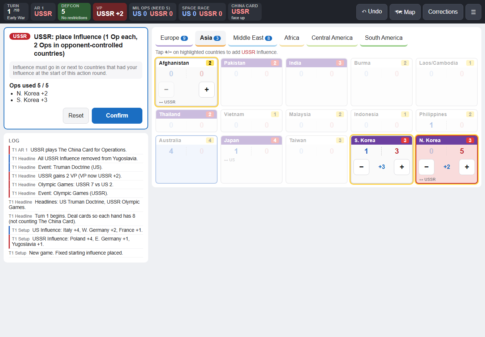
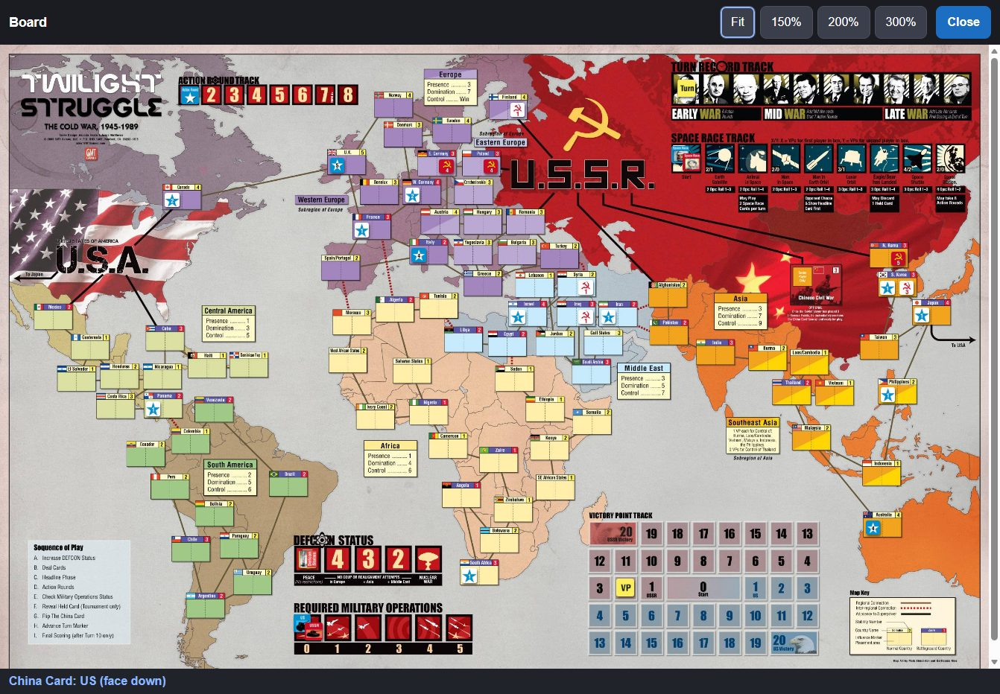

# Twilight Struggle Assistant

A companion app for playing the **physical** Twilight Struggle board game (GMT Deluxe Edition). Keep it on an iPad beside the board. Each time someone plays a card, places influence or rolls a die, you enter it. The app applies the rules, keeps score and stops illegal moves before they reach the board.

It doesn't replace the board, the cards or the dice. Hands stay secret, everyone rolls real dice, and the app records what happened.

**Open it:** https://echuca.github.io/TSA/



## What it does

- **Walks through the turn sequence:** DEFCON improvement, dealing, headlines (in the correct order), action rounds, the required military ops check, flipping The China Card and final scoring after turn 10.
- **Checks every move against the rules.** Influence can only go where it's allowed, and the ops cost goes up in opponent-controlled countries. Coups and realignments respect DEFCON, NATO and the US/Japan Pact. The space race enforces its ops and attempt limits. Options that aren't allowed are greyed out with the reason shown.
- **Works out ops values,** including Containment, Brezhnev Doctrine, Red Scare/Purge, The China Card's Asia bonus and Vietnam Revolts.
- **Resolves all 110 card events,** including the optional cards 104–110. When an event depends on a hidden hand (Five Year Plan, Missile Envy, Terrorism and so on), the app asks which card was actually taken or discarded.
- **Tracks** influence and control, VP, DEFCON, military ops, the space race, The China Card, events in effect and which cards have been discarded or removed.
- **Ends the game** on 20 VP, control of Europe, nuclear war (DEFCON 1), Wargames or final scoring.

## Using it at the table

1. **Start a game.** Choose whether to include the optional cards and any extra US influence from a bid. Each side then places its setup influence.
2. **Answer one question at a time.** The left panel always shows what the app needs next, such as "USSR action round 3: which card is played?" Tap the card (search by name or card number), choose how it's used, then tap countries on the board to place influence or choose targets.
3. **Enter dice.** Roll the real dice and tap the result, or tap **Roll for me**.
4. **Check the log** to see what was applied. Events in effect are listed above it.

**Undo** restarts the current step. If you hadn't entered anything in that step yet, it goes back one step instead. Use it freely; nothing is lost.

**Corrections** is the escape hatch for when the table and the app disagree. You can set influence, VP, DEFCON, military ops, the space race, The China Card, events in effect and card locations by hand. Use it when you reshuffle the discard pile into the draw deck, too.

**🗺 Map** shows the real board with every counter where it should be: influence (control side up when a side controls the country), the Turn, Action Round, DEFCON, VP, Military Ops and Space Race markers, and reminder counters for events in effect. Use it to check the physical board at a glance.



### On the iPad

Open the link in Safari, tap **Share → Add to Home Screen**, and launch it from there. It then runs full-screen and works offline.

The game is saved automatically on the device after every step, so you can close the app and carry on later with **Resume saved game**. Saves don't sync between devices, and clearing Safari's website data deletes them.

## Development

Requires the [.NET 10 SDK](https://dotnet.microsoft.com/download).

```bash
dotnet build TSA.slnx
dotnet test TSA.Tests/TSA.Tests.csproj
dotnet run --project TSA/TSA.csproj --launch-profile http     # http://localhost:5054
```

To try it on an iPad over your home network, run it with `--urls http://0.0.0.0:5054` and open `http://<your PC's IP>:5054`. The installed, offline version needs HTTPS, so use the GitHub Pages site for that.

| Project | What it is |
| --- | --- |
| `TSA.Core` | The rules engine: map and card data, rules, turn flow and card events. No UI code. |
| `TSA` | The Blazor WebAssembly app: a static site that runs entirely in the browser. |
| `TSA.Tests` | xUnit tests, including the rulebook's worked examples. |

The engine runs the game as ordinary async code. It pauses on a "decision" whenever it needs a player's input, which the UI shows and the tests answer from a script. [CLAUDE.md](CLAUDE.md) covers the architecture, conventions, the rules interpretations made and the known gaps.

### Deployment

Every push to `main` runs [`.github/workflows/deploy-pages.yml`](.github/workflows/deploy-pages.yml). It runs the tests, publishes the app and deploys it to GitHub Pages. `tools/prepare-pages.mjs` adjusts the published site to run under the `/TSA/` path. To set up Pages the first time, go to **Settings → Pages → Build and deployment → Source** and choose **GitHub Actions**.

## Not yet supported

- The Chinese Civil War variant and promotional cards
- Tracking how many cards each player holds, or checking for held scoring cards at the end of a turn
- Placing influence by tapping the map view (influence is entered on the region tiles)

## Credits

Twilight Struggle was designed by Ananda Gupta and Jason Matthews and is published by [GMT Games](https://www.gmtgames.com/). This is an unofficial fan-made tool for owners of the game and is not affiliated with or endorsed by GMT Games. The board and counter artwork remain the property of their copyright holders.
